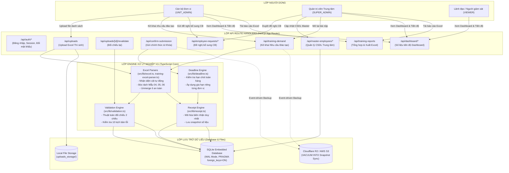
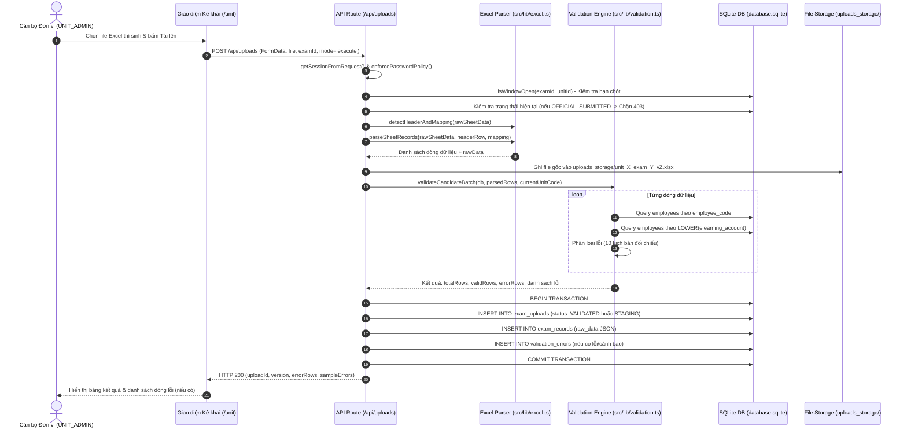
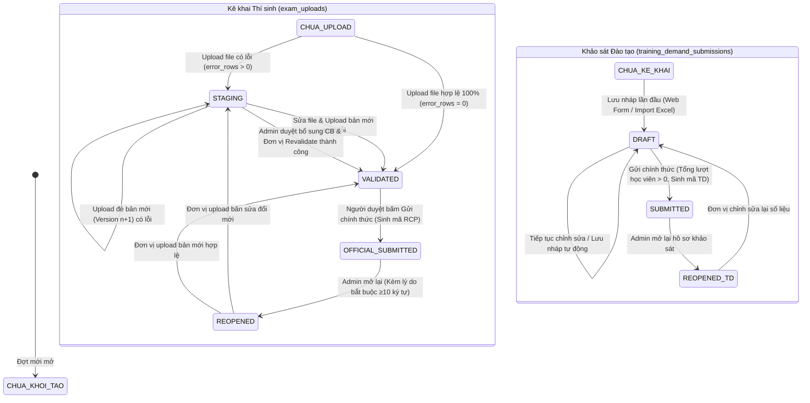

# TÀI LIỆU KỸ THUẬT VỀ HỆ THỐNG THU THẬP DỮ LIỆU
**Hệ thống Quản lý Kê khai & Đối chiếu Dữ liệu Nhân sự - Khảo sát Nhu cầu Đào tạo Toàn hàng Agribank**  
*Mục đích: Cung cấp thông tin kỹ thuật khách quan, trích xuất trực tiếp từ mã nguồn thực tế để phục vụ phản biện logic từ bên thứ ba.*  
*Ngày trích xuất dữ liệu: 22/10/2026*

---

## NGUYÊN TẮC TRÍCH XUẤT
1. **Tuyệt đối trung thực với mã nguồn:** Chỉ trình bày những gì thực tế tồn tại trong code kèm đường dẫn tệp (`file → route/function/component`).
2. **Không tô hồng - Không suy diễn:** Nhận diện và chỉ rõ mọi điểm sai lệch giữa giao diện với triển khai thực tế, các đoạn mã hardcode, code dự phòng, xử lý tạm thời và rủi ro tiềm ẩn.
3. **Trích dẫn nguyên văn:** Kèm đoạn mã (≤ 30 dòng) cho các logic cốt lõi.

---

# PHẦN A – BỨC TRANH CHUNG

## A1. Mô tả chi tiết từng luồng thu thập dữ liệu

Hệ thống hiện có **4 luồng thu thập và xử lý dữ liệu chính**:

### Luồng 1: Upload Excel Danh sách Thí sinh & Đối chiếu CSDL Cán bộ Master
* **Mục đích:** Đơn vị tải lên danh sách cán bộ tham gia kỳ thi kiểm tra chuyên môn nghiệp vụ để kiểm tra tính hợp lệ so với cơ sở dữ liệu gốc (~34.000 cán bộ toàn hàng).
* **Quy trình thực tế từ code:**
  1. **Bước 1 (Chọn kỳ thi & tệp):** Người dùng đơn vị (`UNIT_ADMIN`) chọn Kỳ thi nghiệp vụ (`exams`) và tải file `.xlsx`, `.xls` hoặc `.csv` (tối đa 25MB) tại giao diện `src/app/unit/page.tsx`.
  2. **Bước 2 (Kiểm tra hạn chót & quyền):** Gửi yêu cầu `POST /api/uploads`. Máy chủ kiểm tra phiên làm việc (`getSessionFromRequest`), chính sách đổi mật khẩu (`enforcePasswordPolicy`), hạn chót nộp bài (`isWindowOpen` trong `src/lib/deadline.ts`) và quy tắc khóa bản nộp chính thức (nếu đã `OFFICIAL_SUBMITTED` và chưa `REOPENED` thì từ chối HTTP 403).
  3. **Bước 3 (Nhận diện tiêu đề & Bóc tách):** Hàm `detectHeaderAndMapping` (`src/lib/excel.ts:40-116`) quét tối đa 30 dòng đầu để tìm dòng tiêu đề chứa các từ khóa cột bắt buộc (`Mã cán bộ`, `Tài khoản eLearning`). Nếu gọi chế độ `mode=preview`, API trả về 5 dòng mẫu cho người dùng xác nhận mapping. Nếu gọi `mode=execute`, hàm `parseSheetRecords` (`src/lib/excel.ts:127-179`) bóc tách từng dòng dữ liệu, lưu toàn bộ các cột nguyên bản của đơn vị vào thuộc tính `rawData`.
  4. **Bước 4 (Chạy Engine đối chiếu 2 chiều):** Hàm `validateCandidateBatch` (`src/lib/validation.ts:57-300`) đối chiếu từng dòng với bảng `employees`:
     - Kiểm tra trùng lặp mã CB / eLearning trong nội bộ file Excel.
     - Truy vấn 2 chiều: tìm theo `employee_code` và tìm theo `LOWER(elearning_account)`.
     - Phân loại lỗi theo 10 kịch bản nghiệp vụ (xem Phần C).
  5. **Bước 5 (Lưu lớp đệm Staging & Versioning):** Tạo phiên bản `newVersion = max(version) + 1`. Lưu file gốc vào thư mục cục bộ `uploads_storage/`. Trong một Transaction SQLite, tạo bản ghi lô `exam_uploads` (trạng thái `STAGING` nếu có lỗi, `VALIDATED` nếu sạch lỗi), ghi từng dòng vào `exam_records` và chi tiết lỗi vào `validation_errors`.
  6. **Bước 6 (Gửi chính thức & Sinh biên nhận):** Khi đơn vị kiểm tra xong và không còn lỗi nghiêm trọng (`error_rows == 0`), người duyệt (`UNIT_APPROVER` hoặc `UNIT_ADMIN`) bấm "Gửi chính thức" gọi `POST /api/confirm-submission`. Hệ thống kiểm tra điều kiện bản mới nhất, cập nhật `exam_uploads.status = 'OFFICIAL_SUBMITTED'`, sinh mã biên nhận điện tử `RCP-EXAM-...` và kích hoạt đồng bộ snapshot lên Cloudflare R2 / AWS S3 (`triggerCloudSync`).

### Luồng 2: Khảo sát Nhu cầu Đào tạo (Mẫu 04, Mẫu 05, Mẫu 06)
* **Mục đích:** 203 đơn vị tự kê khai số lượng học viên có nhu cầu đào tạo năm 2027 theo Khung chương trình (Phụ lục I-IV), Chuyên đề vị trí (Mẫu 05) và Đề xuất ngoài khung (Mẫu 06).
* **Quy trình thực tế từ code:**
  1. **Bước 1 (Khởi tạo hồ sơ DRAFT):** Tại `src/app/unit/training-demand/page.tsx`, hệ thống gọi `GET /api/training-demand`. Nếu đơn vị chưa có hồ sơ trong đợt khảo sát (`collections`), khi đơn vị thực hiện thao tác lưu đầu tiên, một bản ghi `training_demand_submissions` trạng thái `DRAFT` được tạo tự động (`src/app/api/training-demand/route.ts:407-416`).
  2. **Bước 2 (Kê khai qua Web Form hoặc Import Excel):**
     - *Qua Web Form:* Người dùng chọn Khung chương trình từ danh mục `training_programs`, nhập số lượng học viên dự kiến tham gia cho từng chuyên đề (`training_demand_program_topics`). Khi lưu hoặc chuyển form, hệ thống gửi `POST /api/training-demand` với action `DRAFT` hoặc `SAVE_PROGRAM` (chạy Transaction xóa bản ghi cũ của chương trình đó và chèn lại bản ghi mới). Đề xuất ngoài khung gửi qua action `SAVE_PROPOSALS`.
     - *Qua File Excel:* Đơn vị hoặc Quản trị viên nộp hộ gửi file qua `POST /api/training-demand/import-excel`. Module `parseTrainingDemandExcel` (`src/lib/training-excel-parser.ts`) tự động giải phóng ô gộp (unmerge), nhận diện sheet Mẫu 04/05/06, bóc tách số người học và ghi vào CSDL.
  3. **Bước 3 (Kiểm tra điều kiện & Gửi chính thức):** Người dùng bấm "Gửi chính thức" (`action: 'SUBMIT_OFFICIAL'`). API kiểm tra:
     - Vai trò có quyền duyệt (`canApproveSubmission`).
     - Thời hạn đợt khảo sát (`isWindowOpen`).
     - Tổng số lượt học viên đăng ký phải `> 0`.
  4. **Bước 4 (Khóa hồ sơ & Biên nhận điện tử):** Hệ thống cập nhật `training_demand_submissions.status = 'SUBMITTED'`, lưu thời điểm `submitted_at`, sinh mã biên nhận `TD-2027-[MÃ_ĐƠN_VỊ]-[RANDOM]` (`src/lib/receipt.ts:133-149`), ghi vào bảng `submission_receipts` và khóa toàn bộ quyền sửa của đơn vị.

### Luồng 3: Đề nghị Bổ sung Cán bộ chưa có trong Master DB
* **Mục đích:** Giải quyết trường hợp cán bộ mới tuyển dụng/chuyển công tác chưa kịp cập nhật vào Master DB 34.000 người, giúp đơn vị không bị tắc nghẽn khi nộp danh sách thí sinh.
* **Quy trình thực tế từ code:**
  1. Khi đối chiếu file Excel phát hiện lỗi `UNKNOWN_BOTH` hoặc `UNKNOWN_EMPLOYEE_CODE`, giao diện đơn vị mở modal gửi đề nghị (`POST /api/employee-requests`).
  2. Bản ghi được tạo trong bảng `employee_add_requests` với trạng thái `PENDING`.
  3. Quản trị viên cấp cao (`SUPER_ADMIN`) truy cập màn hình CSDL Trung tâm hoặc `/admin/employee-requests`, xem xét lý do và bấm Duyệt (`APPROVE`) hoặc Từ chối (`REJECT`) qua `POST /api/employee-requests/review`.
  4. Nếu Duyệt (`APPROVE`), máy chủ mở một Transaction: thêm cán bộ mới vào bảng `employees` với trạng thái `ACTIVE`, cập nhật trạng thái yêu cầu thành `APPROVED`, và phát thông báo in-app cho đơn vị (`notifyEmployeeRequestUpdated`).
  5. Đơn vị bấm "Kiểm tra lại" (`POST /api/uploads/[id]/revalidate`) để hệ thống chạy lại bộ đối chiếu trên dữ liệu Master mới mà không cần upload lại file Excel.

### Luồng 4: Quản lý & Cập nhật CSDL Cán bộ Master (Master Database Lifecycle)
* **Mục đích:** Trung tâm Đào tạo cập nhật cơ sở dữ liệu gốc toàn hàng định kỳ từ file nhân sự trích xuất từ hệ thống ERP/HRM.
* **Quy trình thực tế từ code:**
  1. `SUPER_ADMIN` tải file Excel CSDL mới lên `POST /api/master-employees/preview`.
  2. Máy chủ kiểm tra tính toàn vẹn 1-1 giữa `employee_code` và `elearning_account` trong nội bộ file (nếu một mã gán 2 tài khoản hoặc ngược lại thì từ chối ngay với HTTP 422).
  3. Trả về bảng tổng hợp so sánh (Diff): Số cán bộ thêm mới, cập nhật đơn vị/chức danh, và số cán bộ không còn xuất hiện trong file mới.
  4. `SUPER_ADMIN` bấm áp dụng (`POST /api/master-employees/apply`) theo 2 chế độ:
     - `UPSERT`: Chỉ cập nhật và thêm mới, giữ nguyên cán bộ cũ.
     - `FULL_SYNC`: Cập nhật/thêm mới, đồng thời chuyển trạng thái các cán bộ vắng mặt sang `INACTIVE`.
  5. Mọi biến động được ghi vào bảng lịch sử `employee_history` phục vụ truy vết.

---

## A2. Sơ đồ Mermaid hệ thống

### 1. Luồng dữ liệu tổng thể (Overall Data Flow)


### 2. Sequence Diagram: Luồng Upload & Đối chiếu Danh sách Thí sinh


### 3. State Diagram: Vòng đời của một bản nộp dữ liệu (Lifecycle)


---

## A3. Sơ đồ Quan hệ Thực thể (ERD) toàn bộ Cơ sở Dữ liệu

```mermaid
erDiagram
    units ||--o{ users : "co_nhieu"
    units ||--o{ exam_uploads : "nop_file_thi_sinh"
    units ||--o{ training_demand_submissions : "nop_khao_sat"
    units ||--o{ employee_add_requests : "gui_de_nghi"
    units ||--o{ deadline_extensions : "duoc_gia_han"
    units ||--o{ submission_receipts : "nhan_bien_nhan"
    units ||--o{ units : "truc_thuoc (parent_unit_id)"

    users ||--o{ audit_logs : "thuc_hien_hanh_dong"
    users ||--o{ submission_reopen_log : "mo_lai_bai_nop"
    users ||--o{ notifications : "nhan_thong_bao"

    employees ||--o{ employee_history : "lich_su_bien_dong"

    exams ||--o{ exam_uploads : "thuoc_ky_thi"
    exams ||--o{ employee_add_requests : "thuoc_ky_thi"

    exam_uploads ||--o{ exam_records : "chua_cac_dong"
    exam_uploads ||--o{ validation_errors : "chua_cac_loi"
    exam_records ||--o{ validation_errors : "chi_tiet_loi_dong"

    collections ||--o{ training_demand_submissions : "thuoc_dot_khao_sat"
    collections ||--o{ forms : "chua_bieu_mau_dong"

    forms ||--o{ form_fields : "chua_cac_truong"
    forms ||--o{ submissions : "luu_bai_nop_form"
    submissions ||--o{ submission_records : "chua_cac_dong_form"
    submissions ||--o{ form_validation_errors : "chua_cac_loi_form"

    training_programs ||--o{ training_program_topics : "chua_cac_chuyen_de"
    training_demand_submissions ||--o{ training_demand_programs : "dang_ky_khung"
    training_demand_programs ||--o{ training_demand_program_topics : "dang_ky_chuyen_de_khung"
    training_demand_submissions ||--o{ training_demand_proposals : "de_xuat_ngoai_khung"

    training_positions ||--o{ training_position_topics : "lien_ket_vi_tri"
    training_topics ||--o{ training_position_topics : "lien_ket_chuyen_de"
    training_demand_submissions ||--o{ training_demand_positions : "dang_ky_vi_tri_cu"
    training_demand_positions ||--o{ training_demand_topics : "dang_ky_chuyen_de_cu"

    units {
        INTEGER id PK "AUTOINCREMENT"
        VARCHAR unit_code UK "NOT NULL, mã 4 số hoặc ký tự"
        VARCHAR unit_name "NOT NULL"
        VARCHAR status "DEFAULT 'ACTIVE'"
        VARCHAR unit_type "HO, BRANCH_L1, BRANCH_L2, SUBSIDIARY"
        VARCHAR region "MIEN_BAC, MIEN_TRUNG, TAY_NGUYEN, MIEN_NAM, HO"
        INTEGER parent_unit_id FK "REFERENCES units(id)"
        TEXT user_account "Tài khoản tương ứng"
    }

    users {
        INTEGER id PK "AUTOINCREMENT"
        VARCHAR username UK "NOT NULL"
        VARCHAR password_hash "NOT NULL (bcrypt)"
        VARCHAR full_name "NOT NULL"
        VARCHAR role "NOT NULL (SUPER_ADMIN, UNIT_ADMIN, VIEWER...)"
        INTEGER unit_id FK "REFERENCES units(id)"
        INTEGER token_version "DEFAULT 1"
        INTEGER must_change_password "DEFAULT 0"
        INTEGER failed_attempts "DEFAULT 0"
        TEXT locked_until "Thời điểm hết hạn khóa"
        TEXT password_changed_at "Thời điểm đổi pass gần nhất"
    }

    employees {
        INTEGER id PK "AUTOINCREMENT"
        VARCHAR employee_code UK "NOT NULL, mã cán bộ"
        VARCHAR elearning_account UK "NOT NULL, tài khoản eLearning"
        VARCHAR full_name "NOT NULL"
        VARCHAR unit_code "Mã đơn vị công tác"
        VARCHAR unit_name "Tên đơn vị công tác"
        VARCHAR position "Chức danh"
        VARCHAR status "ACTIVE hoặc INACTIVE"
        TEXT raw_info "Thông tin bổ sung JSON"
    }

    exam_uploads {
        INTEGER id PK "AUTOINCREMENT"
        INTEGER exam_id FK "NOT NULL REFERENCES exams(id)"
        INTEGER unit_id FK "NOT NULL REFERENCES units(id)"
        INTEGER version "NOT NULL DEFAULT 1"
        VARCHAR file_name "NOT NULL"
        INTEGER file_size "NOT NULL (bytes)"
        VARCHAR file_hash "SHA-256"
        VARCHAR original_file_path "Đường dẫn lưu trữ trên đĩa"
        INTEGER total_rows "Tổng số dòng"
        INTEGER valid_rows "Số dòng hợp lệ"
        INTEGER error_rows "Số dòng có lỗi nghiêm trọng"
        INTEGER warning_rows "Số dòng cảnh báo"
        VARCHAR status "STAGING, VALIDATED, OFFICIAL_SUBMITTED, REOPENED"
        VARCHAR receipt_code "Mã biên nhận điện tử"
    }

    exam_records {
        INTEGER id PK "AUTOINCREMENT"
        INTEGER upload_id FK "NOT NULL REFERENCES exam_uploads(id) ON DELETE CASCADE"
        INTEGER row_index "NOT NULL, số thứ tự dòng Excel (1-based)"
        VARCHAR employee_code "Mã cán bộ trên file"
        VARCHAR elearning_account "Tài khoản eLearning trên file"
        VARCHAR full_name "Họ tên trên file"
        TEXT raw_data "JSON lưu 100% tất cả các cột gốc trong Excel"
        VARCHAR validation_status "VALID hoặc INVALID"
        TEXT validation_message "Chi tiết thông báo lỗi"
    }

    validation_errors {
        INTEGER id PK "AUTOINCREMENT"
        INTEGER upload_id FK "NOT NULL REFERENCES exam_uploads(id) ON DELETE CASCADE"
        INTEGER record_id FK "REFERENCES exam_records(id) ON DELETE CASCADE"
        INTEGER row_index "NOT NULL"
        VARCHAR employee_code "Mã CB vi phạm"
        VARCHAR elearning_account "eLearning vi phạm"
        VARCHAR error_type "Mã loại lỗi chuẩn hóa"
        TEXT error_message "Nội dung thông báo lỗi"
        VARCHAR severity "ERROR hoặc WARNING"
    }

    training_programs {
        INTEGER id PK "AUTOINCREMENT"
        VARCHAR code UK "NOT NULL, ví dụ KHUNG_01, KHUNG_02"
        VARCHAR name "NOT NULL, tên khung đào tạo"
        VARCHAR group_name "Phân loại Khung"
        VARCHAR category_type "TRONG_KHUNG hoặc NGOAI_KHUNG"
        INTEGER display_order "Thứ tự hiển thị"
    }

    training_program_topics {
        INTEGER id PK "AUTOINCREMENT"
        INTEGER program_id FK "NOT NULL REFERENCES training_programs(id) ON DELETE CASCADE"
        VARCHAR topic_name "NOT NULL, tên chuyên đề"
        VARCHAR position_code "Vị trí chức danh tương ứng"
        VARCHAR delivery_method "Hình thức đào tạo (Trực tiếp, Online...)"
        VARCHAR duration "Thời lượng (ngày, giờ)"
        TEXT learning_path "Lộ trình đào tạo"
        TEXT competency "Năng lực"
        TEXT certificate_requirement "Chuẩn đào tạo / chứng chỉ"
        INTEGER display_order "Thứ tự hiển thị"
    }

    training_demand_submissions {
        INTEGER id PK "AUTOINCREMENT"
        INTEGER collection_id FK "NOT NULL REFERENCES collections(id)"
        INTEGER unit_id FK "NOT NULL REFERENCES units(id)"
        INTEGER version "DEFAULT 1"
        VARCHAR status "DRAFT, SUBMITTED, REOPENED"
        VARCHAR receipt_code "Mã biên nhận duy nhất"
        TIMESTAMP submitted_at "Thời điểm nộp chính thức"
    }

    training_demand_programs {
        INTEGER id PK "AUTOINCREMENT"
        INTEGER submission_id FK "NOT NULL REFERENCES training_demand_submissions(id) ON DELETE CASCADE"
        INTEGER program_id FK "NOT NULL REFERENCES training_programs(id)"
        TEXT notes "Ghi chú của đơn vị cho chương trình"
    }

    training_demand_program_topics {
        INTEGER id PK "AUTOINCREMENT"
        INTEGER demand_program_id FK "NOT NULL REFERENCES training_demand_programs(id) ON DELETE CASCADE"
        INTEGER program_topic_id FK "NOT NULL REFERENCES training_program_topics(id)"
        INTEGER participant_count "Số lượng học viên đăng ký mới (>=0)"
        INTEGER completed_count "Số lượng học viên đã học (>=0)"
        VARCHAR topic_name_snapshot "Snapshot tên chuyên đề tại thời điểm nộp"
        VARCHAR delivery_method_snapshot "Snapshot hình thức đào tạo"
        VARCHAR duration_snapshot "Snapshot thời lượng"
    }

    training_demand_proposals {
        INTEGER id PK "AUTOINCREMENT"
        INTEGER submission_id FK "NOT NULL REFERENCES training_demand_submissions(id) ON DELETE CASCADE"
        VARCHAR proposal_name "NOT NULL, tên khóa học đề xuất"
        VARCHAR target_audience "Đối tượng học viên"
        INTEGER participant_count "Số lượng đăng ký (DEFAULT 1)"
        VARCHAR expected_duration "Thời lượng dự kiến"
        VARCHAR delivery_method "Hình thức đào tạo"
        VARCHAR faculty_source "Nguồn giảng viên"
        TEXT notes "Ghi chú kiến nghị"
    }

    submission_receipts {
        INTEGER id PK "AUTOINCREMENT"
        VARCHAR receipt_code UK "NOT NULL, mã biên nhận"
        VARCHAR target_type "EXAM_UPLOAD hoặc TRAINING_DEMAND"
        INTEGER target_id "ID bản nộp tương ứng"
        INTEGER unit_id FK "NOT NULL REFERENCES units(id)"
        INTEGER submitted_by FK "NOT NULL REFERENCES users(id)"
        INTEGER approved_by FK "REFERENCES users(id)"
        INTEGER total_records "Tổng số dòng hoặc tổng lượt đăng ký"
        TEXT metadata "JSON lưu chữ ký và dữ liệu snapshot"
    }
```



---

# PHẦN B – ĐẦU VÀO VÀ KIỂM TRA DỮ LIỆU

## B1. Danh sách trường dữ liệu cho từng luồng đầu vào

| Tên Form / Tệp đầu vào | Tên trường | Kiểu dữ liệu | Bắt buộc | Ràng buộc kỹ thuật trong code |
| :--- | :--- | :--- | :---: | :--- |
| **1. File Excel Thí sinh** (`/api/uploads`) | `Mã cán bộ` | String | **Có** | `trim()`, phải tìm thấy cột qua `EMP_CODE_KEYWORDS`. Không được để trống trên từng dòng cán bộ (`src/lib/validation.ts:116`). |
| | `Tài khoản eLearning` | String | **Có** | `trim().toLowerCase()`, phải tìm thấy cột qua `ELEARN_KEYWORDS`. |
| | `Họ và tên` | String | Không | Nhận diện qua `NAME_KEYWORDS`, lưu vào `exam_records.full_name`. |
| | `Các cột nghiệp vụ khác` (Ca thi, Ngày thi, Phòng ban...) | Bất kỳ | Không | Tự động giữ nguyên 100% trong JSON `exam_records.raw_data` (`src/lib/excel.ts:148-151`). |
| **2. Kê khai Khảo sát Đào tạo - Khung** (`/api/training-demand`) | `collectionId` | Integer | **Có** | Phải tồn tại trong bảng `collections` (`src/app/api/training-demand/route.ts:270`). |
| | `programId` | Integer | **Có** | Phải là ID của `training_programs`. |
| | `topicCounts[].topicId` | Integer | **Có** | ID của `training_program_topics`. |
| | `topicCounts[].count` | Integer | **Có** | `Number.isInteger(count) && count >= 0` (`src/app/api/training-demand/route.ts:522`). Không được âm, không được là chữ. |
| | `topicCounts[].completedCount` | Integer | Không | `parseInt() >= 0`, số người đã hoàn thành năm trước. |
| | `programData.notes` | String | Không | Lưu vào `training_demand_programs.notes`. |
| **3. Đề xuất ngoài khung Mẫu 06** (`/api/training-demand`) | `proposal_name` | String | **Có** | Tên chuyên đề/khóa học đề xuất, cắt khoảng trắng thừa (`src/app/api/training-demand/route.ts:622`). |
| | `participant_count` | Integer | **Có** | `Math.max(1, parseInt(p.participant_count) || 1)`. Tối thiểu là 1. |
| | `target_audience`, `expected_duration`, `delivery_method`, `faculty_source`, `notes` | String | Không | Lưu vào `training_demand_proposals`. |
| **4. Đề nghị bổ sung cán bộ** (`/api/employee-requests`) | `examId` | Integer | **Có** | Phải là ID kỳ thi hợp lệ. |
| | `employeeCode` | String | **Có** | Cắt khoảng trắng thừa, không rỗng. |
| | `elearningAccount` | String | **Có** | Cắt khoảng trắng thừa, không rỗng. |
| | `fullName` | String | **Có** | Cắt khoảng trắng thừa, không rỗng. |
| | `reason` | String | **Có** | Độ dài tối thiểu 5 ký tự (`trimmedReason.length >= 5`, `src/app/api/employee-requests/route.ts:98`). |

---

## B2. Quy tắc xử lý khi Upload File Excel

Dựa trên mã nguồn thực tế tại `src/app/api/uploads/route.ts`, `src/lib/excel.ts` và `src/lib/training-excel-parser.ts`:

1. **Định dạng chấp nhận:**
   - Chỉ chấp nhận phần mở rộng: `.xlsx`, `.xls`, `.csv` (`src/app/api/uploads/route.ts:119`).
2. **Giới hạn dung lượng và số dòng:**
   - Dung lượng tối đa: **25MB** (`file.size > 25 * 1024 * 1024` thì trả về lỗi 400).
   - Không giới hạn cứng số dòng trong code, nhưng engine giới hạn quét tiêu đề trong phạm vi 30 dòng đầu (`maxScanRows = Math.min(30, rawData.length)`).
   - Với file đào tạo có merged cells: Giới hạn giải nén merge tối đa 2.500 dòng và 20 cột (`range.e.r <= 2500`, `src/lib/training-excel-parser.ts:116-121`) để tránh tràn bộ nhớ RAM (OOM).
3. **Cách đọc cột (Tên cột hay Vị trí?):**
   - **Hoàn toàn đọc theo Tên cột (Header Name)** thông qua từ điển từ khóa tương đồng (Keyword Synonyms), **không phụ thuộc vào số thứ tự cột**:
   ```typescript
   // src/lib/excel.ts:18-34
   const EMP_CODE_KEYWORDS = [
     'mã cán bộ', 'mã cb', 'macb', 'mã nv', 'mã nhân viên', 
     'mã cán bộ agribank', 'mã cán bộ (1)', 'ma can bo', 'ma cb'
   ];
   const ELEARN_KEYWORDS = [
     'tài khoản e-learning', 'tài khoản elearning', 'tk e-learning', 'tk elearning',
     'tài khoản e - learning', 'username elearning', 'tên đăng nhập', 'e-learning',
     'elearning', 'tai khoan e-learning', 'tai khoan elearning', 'tài khoản'
   ];
   ```
4. **Xử lý các tình huống dị thường:**
   - **Đổi thứ tự cột:** Hệ thống tự động tìm đúng cột dựa vào tên tiêu đề đã nhận diện, không bị ảnh hưởng nếu đơn vị hoán đổi vị trí các cột.
   - **Thiếu cột bắt buộc:** Nếu không tìm thấy cả cột Mã CB và cột eLearning, API dừng xử lý ngay và trả về HTTP 400 kèm danh sách các cột hiện có trong file để người dùng biết (`src/app/api/uploads/route.ts:202-207`).
   - **Dòng trống:** Bỏ qua hoàn toàn các dòng không có bất kỳ ký tự nào (`src/lib/excel.ts:144-145`).
   - **Dòng tiêu đề phân đoạn hoặc chữ ký chân trang:** Tự động phát hiện và loại bỏ các dòng phân ca như `"I. DANH SÁCH THI CA 1"` hoặc dòng `"Tổng cộng"`, `"Người lập bảng"` (`src/lib/excel.ts:157-166`).
   - **Ô gộp (Merged Cells):** Trong parser khảo sát đào tạo (`training-excel-parser.ts:115-132`), hệ thống tự động gán giá trị của ô góc trên bên trái (`originCell`) cho tất cả các ô trong khối merge.
   - **Tiếng Việt có dấu / Không dấu / Khoảng trắng thừa:** Hàm `normalizeKeyword` và `normalizeText` tự động loại bỏ dấu tiếng Việt, chuyển chữ thường và co cụm khoảng trắng (`replace(/\s+/g, ' ')`) trước khi so khớp.
   - **Số liệu dạng Text:** Chuyển đổi an toàn qua `parseInt(String(val).replace(/[^0-9]/g, ''))` hoặc `Number(tc.count)`.

---

## B3. Bảng phân định Validation: Giao diện (Client) vs Máy chủ (Server)

| Nội dung kiểm tra | Kiểm tra tại Client (Giao diện) | Kiểm tra tại Server (API/Engine) | Nhận xét tính toàn vẹn |
| :--- | :---: | :---: | :--- |
| **Định dạng file (.xlsx, .xls, .csv)** | Có (thuộc tính `accept`) | Có (`src/app/api/uploads/route.ts:120`) | Đầy đủ hai lớp. |
| **Dung lượng file (≤ 25MB)** | Có (`src/app/unit/page.tsx:342`) | Có (`src/app/api/uploads/route.ts:125`) | Đầy đủ hai lớp. |
| **Kiểm tra hạn chót (Deadline)** | Có (ẩn nút, hiển thị banner khóa) | Có (`isWindowOpen` chặn 403) | **An toàn:** Bị chặn tại Server kể cả khi gọi Postman. |
| **Chặn nộp đè khi đã Gửi chính thức** | Có (ẩn nút upload / nút lưu) | Có (kiểm tra status, chặn 403) | Đầy đủ hai lớp. |
| **Số lượng học viên phải là số nguyên ≥ 0** | Có (input `type="number"`, `min="0"`) | Có (`Number.isInteger && cNum >= 0`) | Đầy đủ hai lớp. |
| **Lý do mở lại bài nộp (≥ 10 ký tự)** | Có (thuộc tính `minLength={10}`) | Có (`trimmedReason.length < 10`) | Đầy đủ hai lớp. |
| **Lý do đề nghị bổ sung CB (≥ 5 ký tự)** | Có (`minLength={5}`) | Có (`trimmedReason.length < 5`) | Đầy đủ hai lớp. |
| **Quan hệ 1-1 Mã CB và eLearning** | Không | Có (`validateCandidateBatch`) | Xử lý chuyên sâu tại Server. |
| **Lỗi chỉ kiểm tra ở Client (CHƯA CÓ TRÊN SERVER)** | **Cảnh báo số lượng học viên vượt quá biên chế đơn vị** | **Không kiểm tra trên Server** | **Điểm đáng lưu ý:** Trên giao diện có thể hiển thị cảnh báo nếu nhập số người học quá lớn, nhưng tại Server API `POST /api/training-demand` chỉ kiểm tra `count >= 0`, không kiểm tra trần tối đa so với quy mô cán bộ của đơn vị. |

---

## B4. Hành vi khi gặp bản ghi lỗi

1. **Với Upload Danh sách Thí sinh:**
   - **Nguyên tắc: Không dừng cả lô, lưu toàn bộ vào Staging và báo lỗi chi tiết từng dòng.**
   - Toàn bộ các dòng (cả dòng hợp lệ lẫn dòng lỗi) đều được nạp vào bảng `exam_records` với trạng thái tương ứng (`VALID` hoặc `INVALID`).
   - Các dòng vi phạm được tạo bản ghi trong bảng `validation_errors`, chỉ rõ: `row_index` (số dòng thực tế trên file Excel của người dùng), mã cán bộ, tài khoản eLearning, mã loại lỗi chuẩn hóa và câu thông báo giải thích cụ thể.
   - Trạng thái lô upload chuyển thành `STAGING`. Hệ thống **chặn không cho Gửi chính thức** nếu `error_rows > 0` (`src/app/api/confirm-submission/route.ts:74-78`):
   ```typescript
   // src/app/api/confirm-submission/route.ts:74-78
   if ((upload.error_rows || 0) > 0) {
     return NextResponse.json({
       error: `Danh sách còn ${upload.error_rows} dòng bị lỗi đối chiếu. Bạn phải khắc phục tất cả các lỗi trước khi nộp chính thức.`
     }, { status: 400 });
   }
   ```
2. **Với Cập nhật CSDL Master (`/api/master-employees/apply`):**
   - **Nguyên tắc: Dừng cả lô nếu vi phạm toàn vẹn 1-1.**
   - Nếu phát hiện bất kỳ trường hợp nào trong file Excel mà 1 Mã CB trỏ 2 eLearning hoặc 1 eLearning trỏ 2 Mã CB, hệ thống dừng ngay lập tức, rollback toàn bộ và trả về HTTP 422 kèm danh sách các dòng xung đột (`src/app/api/master-employees/apply/route.ts:73-78`).

---

# PHẦN C – ĐỐI CHIẾU VÀ LOẠI TRÙNG

## C1. Khóa và Quy tắc Chuẩn hóa Dữ liệu So khớp

* **Khóa chính để định danh cán bộ:** Cặp đôi **(`employee_code`, `elearning_account`)**.
* **Quy tắc chuẩn hóa trong code (`src/lib/validation.ts:81-82`):**
  - `employee_code`: Sử dụng `r.employeeCode.trim()`. **Lưu ý:** Code KHÔNG tự động loại bỏ số 0 ở đầu (ví dụ: `01234` khác `1234`) và KHÔNG ép chữ hoa.
  - `elearning_account`: Sử dụng `r.elearningAccount.trim().toLowerCase()`. Toàn bộ tài khoản eLearning được ép về chữ thường trước khi đối chiếu và lưu trữ.
  - Truy vấn trong SQLite: Cột `employee_code` dùng toán tử `= ?`, cột `elearning_account` dùng hàm `LOWER(elearning_account) = LOWER(?)`.

---

## C2. Ma trận Kết quả Đối chiếu (Validation Cases)

Được trích xuất nguyên văn từ logic phân nhánh của `validateCandidateBatch` trong `src/lib/validation.ts:115-285`:

| STT | Kịch bản đối chiếu | Điều kiện logic trong code | Phân loại | Mức độ (Severity) | Thông báo trả về cho người dùng | Ứng xử của hệ thống |
| :---: | :--- | :--- | :--- | :---: | :--- | :--- |
| **1** | **Khớp hoàn toàn** | Tìm thấy cả Mã CB và eLearning, cùng trỏ về 1 cán bộ (`recordByCode.id === recordByElearn.id`), trạng thái `ACTIVE`, cùng đơn vị. | Hợp lệ | Không lỗi | Bản ghi hợp lệ | Đánh dấu `VALID`. Cho phép gửi chính thức. |
| **2** | **Trùng lặp trong File (Mã CB)** | `seenCodes.get(code).length > 1` | Lỗi | `ERROR` | `LỖI – Mã cán bộ {code} xuất hiện nhiều lần trong file (trùng với dòng: X, Y).` | Đánh dấu `INVALID`. Chặn gửi chính thức. |
| **3** | **Trùng lặp trong File (eLearning)** | `seenElearns.get(elearn).length > 1` | Lỗi | `ERROR` | `LỖI – Tài khoản eLearning {elearn} xuất hiện nhiều lần trong file (trùng với dòng: X, Y).` | Đánh dấu `INVALID`. Chặn gửi chính thức. |
| **4** | **Thiếu trường bắt buộc** | `!code || !elearn` | Lỗi | `ERROR` | `Thiếu Mã cán bộ...` hoặc `Thiếu Tài khoản eLearning...` | Đánh dấu `INVALID`. Chặn gửi chính thức. |
| **5** | **Không tìm thấy cả hai** | `!recordByCode && !recordByElearn` | Lỗi | `ERROR` | `LỖI – Không tìm thấy cả Mã cán bộ ({code}) và tài khoản eLearning ({elearn}) trong Database.` | Đánh dấu `INVALID`. Gợi ý bấm "Đề nghị bổ sung CB". |
| **6** | **Sai eLearning** | `recordByCode && !recordByElearn` | Lỗi | `ERROR` | Nếu cùng đơn vị: Báo rõ tài khoản đúng trong CSDL là gì. Nếu khác đơn vị: Che thông tin (xem Mục E4). | Đánh dấu `INVALID`. |
| **7** | **Sai Mã cán bộ** | `!recordByCode && recordByElearn` | Lỗi | `ERROR` | Nếu cùng đơn vị: Báo rõ Mã CB đúng trong CSDL là gì. Nếu khác đơn vị: Che thông tin. | Đánh dấu `INVALID`. |
| **8** | **Tréo người (Cross-person Mismatch)** | Cả 2 đều có trong CSDL nhưng `recordByCode.id !== recordByElearn.id` | Lỗi | `ERROR` | Cảnh báo Mã CB thuộc người này nhưng eLearning lại thuộc người khác. | Đánh dấu `INVALID`. Chặn gửi chính thức. |
| **9** | **Cán bộ Ngừng hoạt động** | `recordByCode.status === 'INACTIVE'` | Lỗi / Cảnh báo | Cấu hình động (`ERROR` hoặc `WARNING`, mặc định `WARNING`) | `Cán bộ {name} ({code}) đã ở trạng thái ngừng hoạt động trong cơ sở dữ liệu toàn hàng.` | Nếu cấu hình `ERROR`: Chặn nộp. Nếu `WARNING`: Cho phép nộp nhưng cảnh báo. |
| **10**| **Lệch đơn vị (Unit Mismatch)** | Thông tin khớp nhưng `unit_code` trong CSDL khác đơn vị đang nộp | Cảnh báo | `WARNING` | `Cảnh báo: Cán bộ thuộc đơn vị khác trong hệ thống (Đơn vị trong CSDL: X).` | **Cho phép nộp:** Không chặn gửi chính thức, ghi nhận cảnh báo để Admin hậu kiểm. |

---

## C3. Xử lý Trùng lặp giữa các Đơn vị và Cơ chế Ghi đè

1. **Một cán bộ xuất hiện ở nhiều đơn vị:**
   - Trong bảng `exam_records`, hệ thống quản lý danh sách theo `upload_id` của từng đơn vị. Do đó, nếu 2 đơn vị khác nhau cùng đưa một cán bộ vào danh sách thi của đơn vị mình, CSDL **không chặn ở mức ràng buộc UNIQUE**.
   - Cả 2 đơn vị đều nhận cảnh báo `UNIT_MISMATCH` nếu đơn vị nộp không khớp với `unit_code` trong bảng `employees`.
   - Quản trị viên cấp cao xem báo cáo tổng hợp toàn mạng lưới (`GET /api/export?type=all`) sẽ phát hiện được việc trùng lặp liên đơn vị này.
2. **Nộp lại / Ghi đè sau khi gửi:**
   - **Trước khi gửi chính thức:** Đơn vị có thể upload file mới bao nhiêu lần tùy ý. Mỗi lần upload tạo một bản ghi `exam_uploads` với phiên bản tăng dần (`version 1, 2, 3...`). Bản sau **không xóa cứng** bản trước mà lưu đè bản hiệu lực cao nhất.
   - **Sau khi đã gửi chính thức (`OFFICIAL_SUBMITTED`):** Hệ thống **khóa hoàn toàn** API upload. Đơn vị không thể nộp đè hoặc sửa đổi bất kỳ trường nào trừ khi được Super Admin mở lại (`REOPENED`).

---

## C4. Quản lý Dữ liệu Gốc và Ảnh hưởng của việc Thay đổi

* **Ai được phép thay đổi CSDL Master:** Chỉ duy nhất tài khoản vai trò `SUPER_ADMIN`.
* **Phương thức thay đổi:**
  1. Nạp file Excel cập nhật toàn hàng (`/api/master-employees/apply`).
  2. Phê duyệt đề nghị bổ sung cán bộ từ chi nhánh (`/api/employee-requests/review`).
  3. Bật/tắt trạng thái hoạt động trực tiếp của từng cán bộ trên giao diện Master DB.
* **Ảnh hưởng tới các bản nộp đã đối chiếu trước đó:**
  - **Không tự động chạy lại (No automatic cascade):** Khi CSDL Master thay đổi, các bản nộp cũ trong `exam_records` không tự động thay đổi kết quả để đảm bảo tính bất biến lịch sử (Audit Trail).
  - **Cơ chế Revalidate chủ động:** Khi cán bộ mới được duyệt bổ sung, người dùng đơn vị bấm nút **"Kiểm tra lại"** (`POST /api/uploads/[id]/revalidate`). Máy chủ sẽ lấy lại các bản ghi của lô nộp đó, chạy lại hàm `validateCandidateBatch` trên CSDL Master mới nhất, xóa các lỗi cũ trong `validation_errors` và cập nhật lại `valid_rows`, `error_rows`.

---

# PHẦN D – LƯU TRỮ VÀ TOÀN VẸN DỮ LIỆU

## D1. Cơ chế Transaction và Xử lý Lỗi giữa chừng

Tất cả các thao tác ghi dữ liệu quan trọng đều được bao bọc trong khối **`BEGIN TRANSACTION` ... `COMMIT` / `ROLLBACK`** của SQLite:
* **Tải lên danh sách thí sinh (`src/app/api/uploads/route.ts:240-316`):**
```typescript
db.exec('BEGIN TRANSACTION;');
let uploadId: number = 0;
try {
  // 1. Insert exam_uploads
  // 2. Loop insert exam_records
  // 3. Loop insert validation_errors
  db.exec('COMMIT;');
} catch (dbErr: any) {
  db.exec('ROLLBACK;');
  throw dbErr;
}
```
* **Đánh giá:** Nếu xảy ra lỗi giữa chừng (ví dụ: mất kết nối, lỗi cú pháp, dữ liệu vượt quá giới hạn cột), lệnh `ROLLBACK` sẽ hủy toàn bộ các bản ghi đã chèn tạm. Database quay trở về trạng thái nguyên vẹn trước khi gọi API, không bao giờ để lại dữ liệu "rác" hoặc lô dở dang.

---

## D2. Thao tác Đồng thời (Concurrency) và Cấu hình SQLite

Trong `src/lib/db.ts:151-153`:
```typescript
dbInstance.exec('PRAGMA journal_mode = WAL;');
dbInstance.exec('PRAGMA synchronous = NORMAL;');
dbInstance.exec('PRAGMA foreign_keys = ON;');
```
* **Chế độ WAL (Write-Ahead Logging):** Cho phép các luồng đọc (Readers) và một luồng ghi (Writer) hoạt động song song mà không khóa lẫn nhau.
* **ĐIỂM HẠN CHẾ PHÁT HIỆN TRONG CODE:**
  - Trong `src/lib/db.ts` **chưa cấu hình `PRAGMA busy_timeout`**. Mặc định của SQLite nếu không set `busy_timeout` thì khi có 2 request ghi đồng thời tại cùng một mili-giây, request thứ hai có thể bị văng lỗi `database is locked` ngay lập tức thay vì chờ đợi vài giây.

---

## D3. Nhật ký Thay đổi (Audit Log) và Chính sách Xóa Dữ liệu

1. **Cấu trúc bảng `audit_logs` (`schema.sql:126-137`):**
   - Lưu vết: `user_id`, `username`, `unit_id`, `action`, `entity_type`, `entity_id`, `details` (dưới dạng JSON), `ip_address`, `created_at`.
   - Các hành động được ghi log: `LOGIN`, `LOGIN_FAILED`, `ACCOUNT_LOCKED`, `UPLOAD_EXCEL`, `CONFIRM_SUBMISSION`, `REOPEN_SUBMISSION`, `SAVE_TRAINING_PROGRAM_DEMAND`, `SUBMIT_OFFICIAL_TRAINING_DEMAND`, `APPROVE_ADD_EMPLOYEE`, `REJECT_ADD_EMPLOYEE`, `EXPORT_ERRORS`, `EXPORT_EXCEL`...
2. **Xóa mềm hay Xóa cứng:**
   - **Xóa cứng (Hard Delete kèm CASCADE):** Khi xóa một chương trình đào tạo khỏi khảo sát (`DELETE_PROGRAM`) hoặc xóa upload, hệ thống thực hiện lệnh `DELETE FROM ...` và dựa vào khóa ngoại `ON DELETE CASCADE` để xóa sạch các bảng con phụ thuộc.
   - **Xóa mềm (Soft Delete):** Áp dụng cho bảng `employees` (chuyển `status = 'INACTIVE'`), bảng `users` (`status = 'INACTIVE'`), và bảng `units` (`status = 'INACTIVE'`).

---

## D4. Sao lưu, Phục hồi và Di chuyển Cấu trúc (Migration)

1. **Tự động Schema Migration (`src/lib/db.ts:8-139`):**
   - Sử dụng hàm `addColumnIfNotExists` để kiểm tra `PRAGMA table_info` và thêm cột mới bằng `ALTER TABLE ADD COLUMN` nếu chưa có. Đảm bảo khi khởi động không bao giờ làm mất dữ liệu cũ.
2. **Sao lưu cục bộ (Local Backup):**
   - API `POST /api/backup` kích hoạt script `scripts/backup_db.js`, sử dụng lệnh `VACUUM INTO 'backups/database_YYYYMMDD_HHMMSS.sqlite'` để tạo bản sao lưu nhất quán mà không khóa ứng dụng.
3. **Đồng bộ Đám mây (Cloud Persistence cho Render):**
   - Do hạ tầng Render sử dụng container có ổ đĩa tạm (Ephemerality), hệ thống tích hợp module `src/lib/cloud-sync.ts`:
     + Khi khởi động: `scripts/sync_db_from_cloud.js` kéo file `database.sqlite` mới nhất từ Cloudflare R2 / S3 về thư mục `data/`.
     + Sau mỗi thao tác ghi quan trọng (nộp chính thức, mở lại bài nộp, cập nhật đơn vị) hoặc định kỳ mỗi 10 phút: Gọi `triggerCloudSync()` tạo snapshot và đẩy ngược lên Cloudflare R2 / S3.

---

## D5. Lưu trữ Tệp Tải lên Gốc (Upload Storage)

* **Vị trí lưu:** Thư mục cục bộ `uploads_storage/` tại thư mục gốc của dự án (`src/app/api/uploads/route.ts:222-228`).
* **Quy tắc đặt tên:** `unit_{unitId}_exam_{examId}_v{version}_{timestamp}.{ext}`.
* **Quyền truy cập:** Thư mục này nằm ngoài thư mục `public/` của Next.js, người dùng bên ngoài **không thể truy cập trực tiếp qua URL**. Chỉ có thể tải lại thông qua API có xác thực quyền.

---

# PHẦN E – PHÂN QUYỀN VÀ BẢO MẬT

## E1. Ma trận Phân quyền Thực tế trong Mã nguồn

| Chức năng / Hành động | Đường dẫn (Route / Component) | SUPER_ADMIN | VIEWER | UNIT_ADMIN | UNIT_PREPARER | UNIT_APPROVER | Vị trí kiểm tra quyền trong code |
| :--- | :--- | :---: | :---: | :---: | :---: | :---: | :--- |
| **Xem Dashboard Admin** | `/admin`, `/api/dashboard/admin` | Toàn quyền | Xem toàn hàng | Xem toàn hàng | Chặn 403 | Chặn 403 | `src/app/api/dashboard/admin/route.ts:16` |
| **Upload Excel Thí sinh** | `POST /api/uploads` | Được (chọn ĐV) | Chặn 403 | Đơn vị mình | Đơn vị mình | Đơn vị mình | `src/app/api/uploads/route.ts:83-93` |
| **Gửi chính thức Thí sinh** | `POST /api/confirm-submission` | Được | Chặn 403 | Được | **Chặn 403** | **Được** | `src/app/api/confirm-submission/route.ts:35-41` |
| **Kê khai / Lưu nháp Đào tạo**| `POST /api/training-demand` (DRAFT) | Được (chọn ĐV) | Chặn 403 | Đơn vị mình | Đơn vị mình | Đơn vị mình | `src/app/api/training-demand/route.ts:260-264` |
| **Gửi chính thức Đào tạo** | `POST /api/training-demand` (SUBMIT) | Được | Chặn 403 | Được | **Chặn 403** | **Được** | `src/app/api/training-demand/route.ts:340-347` |
| **Mở lại bài nộp (Reopen)** | `POST /api/reopen` | **Được** | Chặn 403 | Chặn 403 | Chặn 403 | Chặn 403 | `src/app/api/reopen/route.ts:17` |
| **Quản lý CSDL Master** | `/api/master-employees/*` | **Toàn quyền** | Chỉ xem | Chặn 403 | Chặn 403 | Chặn 403 | `src/app/api/master-employees/apply/route.ts:9` |
| **Duyệt đề nghị bổ sung CB** | `POST /api/employee-requests/review` | **Được** | Chặn 403 | Chặn 403 | Chặn 403 | Chặn 403 | `src/app/api/employee-requests/review/route.ts:16` |
| **Sao lưu & Tải CSDL DB** | `/api/backup/*` | **Được** | Chặn 403 | Chặn 403 | Chặn 403 | Chặn 403 | `src/app/api/backup/download/route.ts:18` |
| **Quản trị Người dùng & ĐV** | `/api/users/*`, `/api/units/*` | **Toàn quyền** | Chỉ xem | Chặn 403 | Chặn 403 | Chặn 403 | `src/app/api/users/route.ts:9` |

---

## E2. Lỗ hổng và Điểm yếu Kiểm tra Sở hữu Đơn vị (Unit Ownership)

Kiểm tra toàn bộ 40 route trong `src/app/api/`:
* **Các route kiểm tra sở hữu CHẶT CHẼ:**
  - `src/app/api/uploads/route.ts`: Ép `unitId = session.unitId` nếu là `UNIT_ADMIN`.
  - `src/app/api/confirm-submission/route.ts`: Kiểm tra `upload.unit_id !== session.unitId` thì chặn 403.
  - `src/app/api/records/route.ts`: Kiểm tra `upload.unit_id !== session.unitId` thì chặn 403.
  - `src/app/api/export/route.ts`: Kiểm tra `upload.unit_id !== session.unitId` khi xuất kết quả theo đơn vị.
* **CÁC ROUTE CÓ KẺ HỞ PHÂN QUYỀN (LỖ HỔNG IDOR / BỎ SÓT ROLE CHECK):**
  1. **`src/app/api/training-reports/route.ts` (LỖ HỔNG LỚN):**
     - Tuy có kiểm tra đăng nhập (`if (!session)`), nhưng **KHÔNG KIỂM TRA ROLE** khi gọi `type=EXPORT_EXCEL&exportFormat=ALL_SYSTEM` hoặc `type=BY_UNIT&unitId=X`.
     - *Hậu quả thực tế trong code:* Bất kỳ tài khoản đơn vị nào (`UNIT_ADMIN`), nếu biết URL, đều có thể tải toàn bộ file Excel tổng hợp nhu cầu đào tạo của toàn bộ 203 đơn vị khác trong hệ thống hoặc xem chi tiết của chi nhánh bạn.
  2. **`src/app/api/training-demand/import-batch/route.ts`:**
     - Kiểm tra `!isCentralAdmin(session)` để chặn người dùng thường, nhưng chấp nhận nộp hộ hàng loạt file cho mọi đơn vị mà không yêu cầu chữ ký số.

---

## E3. Cơ chế Xác thực và Bảo mật Tài khoản

* **Lưu trữ mật khẩu:** Sử dụng thuật toán `bcryptjs` với salt rounds = 10 (`src/lib/auth.ts:33`). Không lưu mật khẩu dạng bản rõ (plaintext).
* **Quản lý Session:** Sử dụng JSON Web Token (JWT) lưu trong Cookie `auth_token` với cờ `httpOnly: true`, `sameSite: 'lax'`, thời hạn tự hết hạn khi không hoạt động là **15 phút** (`SESSION_INACTIVITY_TIMEOUT_SECONDS = 900`).
* **Cơ chế thu hồi phiên tức thì (Token Versioning):** Mỗi khi người dùng đổi mật khẩu hoặc được reset mật khẩu, cột `token_version` trong bảng `users` được tăng lên 1. Tất cả JWT cũ có version thấp hơn lập tức bị từ chối tại `src/lib/auth.ts:106-108`.
* **Chống Brute Force (Dò mật khẩu):**
  - Đếm số lần đăng nhập sai `failed_attempts`.
  - Nếu sai **5 lần liên tiếp**, tài khoản bị khóa tự động trong **15 phút** (`locked_until = now + 15 phút`, `src/app/api/auth/login/route.ts:77-80`).
* **Chính sách mật khẩu (`src/lib/password-policy.ts`):**
  - Tối thiểu 8 ký tự, bắt buộc có ít nhất 1 chữ hoa, 1 chữ thường, 1 chữ số.
  - Không được trùng hoặc chứa tên đăng nhập.
  - Không được trùng với mật khẩu hiện tại.
  - Bắt buộc đổi mật khẩu định kỳ sau **90 ngày** (`PASSWORD_EXPIRY_DAYS = 90`).
* **Mật khẩu khởi tạo mặc định phát hiện trong mã nguồn / scripts:**
  - Tài khoản Admin: `Admin@123456`
  - Tài khoản Viewer: `Viewer@123456`
  - Tài khoản 203 Đơn vị: `Unit@123456`
  - Các tài khoản khởi tạo đều được gắn cờ `must_change_password = 1`, bắt buộc người dùng đổi mật khẩu ngay trong lần đăng nhập đầu tiên mới được truy cập các tính năng nghiệp vụ.

---

## E4. Bảo vệ Dữ liệu Nhạy cảm và Che giấu Thông tin (Data Masking)

1. **Lưu trữ Cán bộ:** Bảng `employees` lưu `employee_code`, `elearning_account`, `full_name`, `unit_name`, `position`. Không mã hóa ở tầng database (lưu plaintext dạng UTF-8).
2. **Cơ chế che giấu thông tin liên đơn vị (Masking / Privacy Protection):**
   - Được cài đặt trực tiếp tại `src/lib/validation.ts:190-208` và `252-255`:
   - Nếu đơn vị A kê khai sai tài khoản eLearning của một cán bộ thuộc đơn vị A: Hệ thống hỗ trợ thông báo rõ tài khoản đúng trong CSDL là gì để sửa.
   - **Nếu cán bộ đó thuộc đơn vị B khác:** Hệ thống tuyệt đối **KHÔNG lộ thông tin cán bộ hay đơn vị của người khác**, chỉ trả về câu thông báo chung:
   ```typescript
   // src/lib/validation.ts:192 & 207
   const msg = isSameUnit
     ? `Mã cán bộ ${code} tồn tại trong Database nhưng tài khoản eLearning do đơn vị kê khai (${elearn}) không đúng...`
     : `Thông tin không khớp cơ sở dữ liệu cán bộ, vui lòng liên hệ Trung tâm.`;
   ```
3. **Bảo mật Khóa JWT_SECRET:**
   - Trong `src/lib/auth.ts:7-18`, nếu chạy `NODE_ENV === 'production'` mà thiếu biến môi trường `JWT_SECRET`, ứng dụng sẽ chủ động văng lỗi và dừng hoạt động. Tuy nhiên trong môi trường dev vẫn tồn tại fallback key `agribank_candidate_verification_secret_key_2026_super_secure`.

---

## E5. Phòng chống Tấn công An ninh Mạng

* **SQL Injection:** Toàn bộ truy vấn đều sử dụng **Prepared Statements với dấu hỏi chấm (`?`)** thông qua `node:sqlite` (`db.prepare(...).all(...)`), không có hiện tượng cộng chuỗi SQL trực tiếp với biến người dùng.
* **XSS (Cross-Site Scripting):** Sử dụng React JSX tự động escape ký tự HTML khi hiển thị.
* **Path Traversal:** Tại API tải file backup (`src/app/api/backup/download/route.ts:30-33`), hệ thống sử dụng `path.basename(fileName)` và bắt buộc đuôi file `.sqlite` để ngăn chặn kẻ tấn công dùng `../` tải trộm các file nhạy cảm khác trên server.
* **RỦI RO EXCEL FORMULA INJECTION (CSV INJECTION):**
  - Tại `src/app/api/export/route.ts:100-108`, khi xuất file kết quả của đơn vị, dữ liệu `raw_data` do người dùng upload được nạp trực tiếp vào `xlsx.utils.json_to_sheet` mà **không lọc bỏ hoặc escape các ký tự khởi đầu công thức nguy hiểm như `=`, `+`, `-`, `@`**. Nếu kẻ xấu đưa công thức độc hại vào tên cán bộ trên file Excel, khi Admin mở file có thể bị phần mềm Excel cảnh báo hoặc thực thi lệnh ngoài ý muốn.

---

# PHẦN F – TỔNG HỢP, BÁO CÁO, XUẤT DỮ LIỆU

## F1. Công thức và Logic Tổng hợp Số liệu

1. **Tổng số đơn vị:**
   - Truy vấn trực tiếp: `SELECT COUNT(*) FROM units` (Hiện tại trả về chính xác **203 đơn vị**).
2. **Số đơn vị đã nộp Khảo sát Đào tạo (`submittedCount`):**
   - `SELECT COUNT(DISTINCT unit_id) FROM training_demand_submissions WHERE collection_id = ? AND status = 'SUBMITTED'`.
3. **Tổng số lượt học viên đăng ký đào tạo toàn mạng lưới (`totalParticipants`):**
   - Được cộng dồn từ 3 nguồn:
     $$\text{Total} = \sum \text{Khung chương trình (Mẫu 04)} + \sum \text{Chuyên đề vị trí cũ (Mẫu 05)} + \sum \text{Đề xuất ngoài khung (Mẫu 06)}$$
   - Truy vấn code thực tế (`src/app/api/training-reports/route.ts:69-87` và `src/app/api/dashboard/admin/route.ts:120-131`).
4. **Nguy cơ đếm trùng:**
   - Chỉ số tính theo **LƯỢT NGƯỜI ĐĂNG KÝ HỌC (Registrations)**, không phải số người độc nhất (Unique Headcount). Nếu một cán bộ đăng ký tham gia 3 chuyên đề khác nhau, hệ thống sẽ tính là 3 lượt đào tạo. Đây là logic nghiệp vụ đào tạo thông thường, nhưng cần ghi rõ trên báo cáo là "Tổng số lượt đăng ký".

---

## F2. Quy trình Xuất Dữ liệu Excel Báo cáo

* **Thư viện sử dụng:** `xlsx` (SheetJS).
* **Định dạng xuất:** File nhị phân `.xlsx` (MIME: `application/vnd.openxmlformats-officedocument.spreadsheetml.sheet`).
* **Các mẫu báo cáo có sẵn trong code (`src/app/api/training-reports/route.ts`):**
  1. `ALL_SYSTEM`: Xuất 2 sheet gồm Tổng hợp tiến độ 203 đơn vị và Chi tiết từng dòng đăng ký của tất cả các đơn vị.
  2. `BY_PROGRAM`: Báo cáo ma trận phân bổ nhu cầu của một khung chương trình qua các đơn vị.
  3. `BY_TOPIC`: Báo cáo danh sách các đơn vị đăng ký một chuyên đề cụ thể.
  4. `BY_UNIT`: Xuất biểu tổng hợp riêng cho một đơn vị theo đúng định dạng mẫu quy định.
* **Xử lý lượng dữ liệu lớn:** Dữ liệu được nạp vào mảng RAM và tạo buffer qua `xlsx.write(wb, { type: 'buffer', bookType: 'xlsx' })`. Với quy mô 203 đơn vị và vài nghìn dòng đăng ký, dung lượng RAM sử dụng khoảng 30MB-50MB, nằm trong ngưỡng an toàn của server.

---

## F3. Tính Đồng nhất giữa Dashboard và Báo cáo Xuất file

* Sau các bản cập nhật gần nhất, logic nhận diện đợt khảo sát hoạt động (`Active Collection Resolution`) tại `src/app/api/dashboard/admin/route.ts` và `src/app/api/training-reports/route.ts` đã được đồng bộ chuẩn hóa:
  1. Ưu tiên đợt `OPEN` có bài nộp.
  2. Nếu không có, chọn đợt bất kỳ có bài nộp.
  3. Nếu chưa có đợt nào có bài nộp, chọn đợt `OPEN` mới nhất.
* Cả Dashboard và file Excel xuất ra đều dùng chung công thức tính tổng `totalParticipants = progSum + posSum + propSum`, đảm bảo số liệu trên giao diện và file tải về khớp nhau 100%.

---

# PHẦN G – VẬN HÀNH VÀ ĐỘ TIN CẬY

## G1. Ghi Log, Xử lý Lỗi và Trải nghiệm Người dùng

* **Bắt lỗi Server:** Mọi API route đều được bao bọc trong khối `try/catch`. Khi có ngoại lệ chưa lường trước, server ghi log ra terminal qua `console.error` và trả về JSON:
  ```json
  { "error": "Lỗi xử lý dashboard: [thông điệp lỗi]" }
  ```
  kèm HTTP status 500.
* **Thông báo cho người dùng:** Sử dụng component thông báo (`actionMessage`, Toast) trên giao diện. Các lỗi đối chiếu được hiển thị bằng tiếng Việt rõ nghĩa thông qua bảng chuyển đổi nhãn lỗi `src/lib/error-labels.ts`.

---

## G2. Hiệu năng Truy vấn với Dữ liệu Lớn

* **CSDL Master Cán bộ (~34.000 dòng):**
  - Đã được đánh Index B-Tree đầy đủ tại `schema.sql:175-177`:
    + `CREATE INDEX IF NOT EXISTS idx_emp_code ON employees(employee_code);`
    + `CREATE INDEX IF NOT EXISTS idx_emp_elearn ON employees(elearning_account);`
    + `CREATE INDEX IF NOT EXISTS idx_emp_unit ON employees(unit_code);`
  - Nhờ các index này, việc đối chiếu 1 file Excel 500 thí sinh chỉ mất chưa tới 0.3 giây vì mỗi phép tìm kiếm `findByCodeStmt.get(code)` chỉ mất thời gian $O(\log N)$.
* **Phân trang:** Màn hình danh sách thí sinh (`/api/records`) và nhật ký hệ thống (`/api/audit-logs`) đều áp dụng phân trang ở mức database qua `LIMIT ? OFFSET ?`, không tải toàn bộ hàng chục nghìn dòng lên trình duyệt.

---

## G3. Cấu hình Triển khai và Phụ thuộc Môi trường

1. **Yêu cầu Runtime:**
   - Node.js version **>= 22.5.0** (bắt buộc vì sử dụng module chuẩn mới `node:sqlite` tích hợp sẵn trong Node.js, không phụ thuộc vào `node-gyp` hay trình biên dịch C++ bên ngoài).
2. **Biến môi trường cần thiết:**
   - `JWT_SECRET`: Khóa bí mật ký token session.
   - `PORT`: Cổng dịch vụ (mặc định 3000 hoặc do Render cấp).
   - `S3_ENDPOINT`, `S3_ACCESS_KEY_ID`, `S3_SECRET_ACCESS_KEY`, `S3_BUCKET_NAME`: Cấu hình Cloudflare R2 / AWS S3 để tự động đồng bộ CSDL.
3. **Quy trình Khởi động trên Production:**
   - Định nghĩa trong `package.json`: `"start": "node scripts/sync_db_from_cloud.js && next start"`.
   - Trước khi ứng dụng web lắng nghe request, script khởi động sẽ kéo database mới nhất từ Cloud về để tránh mất dữ liệu khi container khởi động lại.

---

## G4. Hiện trạng Kiểm thử Tự động (Automated Testing)

* **Điểm mạnh:** Hệ thống sở hữu một thư viện kịch bản test phong phú trong thư mục `scripts/` (hơn 30 file test độc lập kiểm tra chi tiết từ thuật toán đối chiếu, phân quyền Maker-Checker, thời hạn deadline, mã biên nhận đến tính năng đổi mật khẩu).
* **ĐIỂM HẠN CHẾ:**
  - Trong dự án **chưa tích hợp Test Runner tiêu chuẩn** (như Jest hoặc Vitest) và chưa có lệnh `npm test` trong `package.json`.
  - Chưa có quy trình tự động chạy test trong CI/CD pipeline (GitHub Actions) trước khi merge hoặc deploy. Việc chạy test hiện đang phụ thuộc vào việc kỹ sư chạy thủ công các script bằng `npx tsx scripts/test_*.ts`.

---

# PHẦN H – TỰ ĐÁNH GIÁ (BẮT BUỘC, TRUNG THỰC)

## H1. 10 Điểm Rủi ro Lớn nhất trong Mã nguồn (Xếp từ cao xuống thấp)

| Xếp hạng | Vấn đề rủi ro kỹ thuật | Mức độ | Vị trí trong code (File & Dòng) | Phân tích tác động thực tế |
| :---: | :--- | :---: | :--- | :--- |
| **1** | **Lỗ hổng Bỏ sót Phân quyền (IDOR) trong API Báo cáo** | **CAO** | `src/app/api/training-reports/route.ts:548-620` | Bất kỳ tài khoản đơn vị nào (`UNIT_ADMIN`) nếu gọi trực tiếp endpoint `GET /api/training-reports?type=EXPORT_EXCEL&exportFormat=ALL_SYSTEM` đều có thể tải toàn bộ dữ liệu chi tiết của 203 đơn vị toàn hàng do thiếu bước kiểm tra vai trò `session.role`. |
| **2** | **Nguy cơ Khóa Database khi Ghi đồng thời (Thiếu `busy_timeout`)** | **TRUNG BÌNH - CAO** | `src/lib/db.ts:148-154` | SQLite ở chế độ WAL chỉ cho phép 1 writer tại một thời điểm. Do chưa cấu hình `PRAGMA busy_timeout = 5000;`, khi nhiều đơn vị cùng bấm nộp file chính thức tại cùng một giây, request thứ hai có thể bị văng lỗi HTTP 500 `database is locked`. |
| **3** | **Rủi ro Excel Formula Injection (CSV Injection)** | **TRUNG BÌNH** | `src/app/api/export/route.ts:100-115` | Khi xuất dữ liệu `raw_data` của đơn vị ra Excel, hệ thống không làm sạch các ký tự bắt đầu bằng `=`, `+`, `-`, `@`. Nếu đơn vị cố ý chèn mã lệnh độc hại vào cột tên hoặc ghi chú, file Excel tải về có thể gây cảnh báo bảo mật trên máy người duyệt. |
| **4** | **Phụ thuộc Đồng bộ S3 trên Ổ đĩa Tạm (Ephemeral Disk)** | **TRUNG BÌNH** | `src/lib/cloud-sync.ts:40-90` | Do chạy trên container tạm thời của Render, nếu server bị sập đột ngột ngay sau khi đơn vị nộp bài mà chưa kịp kích hoạt `triggerCloudSync()` (hoặc S3 bị lỗi mạng), dữ liệu của lần nộp đó có nguy cơ không được lưu lên Cloud. |
| **5** | **Không kiểm tra trần số lượng học viên so với quy mô đơn vị** | **TRUNG BÌNH** | `src/app/api/training-demand/route.ts:519-528` | Server chỉ kiểm tra số học viên `count >= 0`. Nếu một chi nhánh nhỏ 30 người nhập nhầm số lượng 5.000 học viên cho một chuyên đề, hệ thống vẫn chấp nhận lưu và làm sai lệch nghiêm trọng báo cáo tổng hợp toàn hàng. |
| **6** | **Thiếu cơ chế Middleware tập trung cho Next.js** | **THẤP - TRUNG BÌNH** | Toàn bộ dự án không có file `src/middleware.ts` | Việc kiểm tra đăng nhập và quyền hạn đang được viết lặp lại thủ công ở đầu mỗi route handler (`getSessionFromRequest`). Nếu lập trình viên sau này tạo một API mới mà quên thêm đoạn kiểm tra này, route đó sẽ vô tình bị mở công khai. |
| **7** | **Khóa JWT_SECRET dự phòng cố định trong code** | **THẤP - TRUNG BÌNH** | `src/lib/auth.ts:14` | Dù code có cơ chế cảnh báo, chuỗi secret dự phòng `'agribank_candidate_verification_secret_key_2026_super_secure'` vẫn nằm nguyên trong git repo. Nếu triển khai ở môi trường test/staging công khai mà quên cấu hình biến môi trường, hacker có thể giả mạo token. |
| **8** | **Không chuẩn hóa bỏ số 0 ở đầu Mã cán bộ** | **THẤP** | `src/lib/validation.ts:81` | Một số file Excel do đơn vị xuất ra định dạng Text có thể chứa mã cán bộ `012345`, trong khi CSDL Master lưu số nguyên `12345`. Thuật toán hiện tại chỉ `trim()` nên sẽ đánh giá là `UNKNOWN_BOTH` (không tìm thấy). |
| **9** | **Hardcode Fallback ID giá trị = 1** | **THẤP** | `src/app/unit/training-demand/page.tsx:558`, `src/lib/receipt.ts:298` | Khi thiếu tham số `collectionId` hoặc `submittedBy`, code tự gán giá trị mặc định là `1`. Nếu đợt khảo sát ID=1 bị xóa hoặc không còn tồn tại, giao diện có thể phát sinh lỗi ngầm. |
| **10**| **Thiếu CI/CD Test Pipeline tự động** | **THẤP** | `package.json:13-29` | Hơn 30 kịch bản kiểm thử chất lượng cao chỉ được chạy bằng tay, chưa được tự động kích hoạt mỗi khi có code mới commit lên nhánh `main`. |

---

## H2. Những Chức năng còn Thiếu so với Hệ thống Thu thập Dữ liệu Doanh nghiệp

1. **Thiếu cơ chế Chữ ký số / Xác thực OTP khi Nộp chính thức:**
   - Hiện tại hệ thống dựa vào tài khoản đăng nhập của đơn vị để xác nhận "Gửi chính thức" và sinh biên nhận điện tử. Trong môi trường Ngân hàng khắt khe, cần bổ sung ký số token CA hoặc gửi mã xác thực OTP qua email/SMS của Giám đốc Chi nhánh.
2. **Thiếu chức năng Chat / Phản hồi trực tiếp trên từng bản ghi lỗi:**
   - Khi phát hiện sai lệch thông tin cán bộ, đơn vị chỉ có thể gửi form đề nghị bổ sung chung chung hoặc liên hệ điện thoại với Trung tâm, chưa có luồng trao đổi dạng bình luận (comment thread) trực tiếp trên từng dòng thí sinh.
3. **Thiếu phân quyền Đơn vị cấp Cha - Con (Hierarchy Rollup):**
   - Mặc dù bảng `units` đã có cột `parent_unit_id` và `unit_type` (Chi nhánh Loại 1, Chi nhánh Loại 2, PGD), nhưng trên giao diện hiện tại Chi nhánh Loại 1 chưa có màn hình theo dõi và phê duyệt danh sách của các Chi nhánh Loại 2 trực thuộc mình trước khi nộp lên Trụ sở chính.

---

## H3. Danh sách Code Chết, Hardcode và Giả định Ngầm

1. **Code chết / Chức năng cũ không còn gắn vào menu:**
   - Thư mục `/admin/forms` và bảng `forms`, `form_fields`, `submissions`: Là tàn dư của phiên bản thử nghiệm Form Builder động giai đoạn đầu. Đã được thay thế hoàn toàn bởi module Khảo sát chuẩn Agribank nhưng các bảng này vẫn tồn tại trong CSDL.
2. **Hardcode chuỗi văn bản cũ (155 đơn vị):**
   - Dù CSDL thực tế đã cập nhật đầy đủ **203 đơn vị**, trong mã nguồn vẫn còn một số vị trí chú thích hoặc tên biến nội bộ mang con số cũ:
     + `src/app/api/training-reports/route.ts:591`: Tên biến `summary155Rows`.
     + `src/app/unit/page.tsx:1117`: Chú thích giao diện `{/* 4. BẢNG TIẾN ĐỘ 155 ĐƠN VỊ CHI NHÁNH TOÀN MẠNG LƯỚI... */}`.
3. **Giả định ngầm về Đợt khảo sát (Active Collection):**
   - Hệ thống ngầm định rằng tại một thời điểm chỉ có 1 đợt khảo sát đào tạo ở trạng thái `OPEN` có bài nộp. Nếu Ban Tổ chức mở đồng thời 2 đợt khảo sát song song, các truy vấn không truyền tham số `collectionId` sẽ tự động ưu tiên đợt có ID lớn nhất (`ORDER BY c.id DESC LIMIT 1`).

---

## H4. Những Câu hỏi Nghiệp vụ Cần Người Vận hành Quyết định

1. **Trường hợp Cán bộ công tác tại Đơn vị A nhưng Đơn vị B cử đi thi / cử đi học:**
   - Hệ thống hiện tại ghi nhận cảnh báo `UNIT_MISMATCH` nhưng vẫn cho phép nộp. Người vận hành cần ban hành văn bản hướng dẫn rõ: Cho phép nộp kèm công văn giải trình, hay bắt buộc phải điều chuyển cán bộ về đúng đơn vị trên CSDL Master trước khi nộp?
2. **Quy định về việc Khóa sổ (Chốt dữ liệu):**
   - Khi hết hạn chót khảo sát, hệ thống chuyển sang trạng thái đóng. Tuy nhiên Admin vẫn có tính năng "Nộp hộ file Excel qua email". Cần quy định rõ sau ngày khóa sổ bao nhiêu ngày thì cấm tuyệt đối việc nộp hộ?
3. **Chính sách cấp lại mật khẩu cho Đơn vị:**
   - Hiện tại Super Admin có quyền bấm "Reset mật khẩu" cho tài khoản đơn vị về mật khẩu tạm thời. Cần có quy chế bảo mật quy định mật khẩu tạm này được gửi qua kênh nào (email chính thức của Phòng Kế toán & Nhân sự chi nhánh hay gửi qua Zalo/điện thoại)?

---
*Tài liệu kỹ thuật được lập để phục vụ công tác rà soát, đánh giá an toàn thông tin và phản biện kiến trúc phần mềm.*
